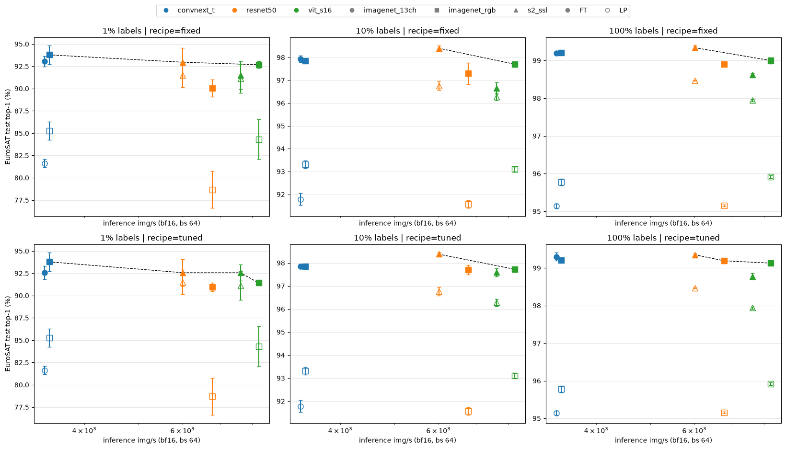

# backbone_bakeoff

A small harness for comparing pretrained backbones on satellite imagery: apply training recipes to different models and initialisations, run them at different label budgets, fine-tune or linear-probe, and compare the results side by side, including speed.

- **One config per run:** a YAML file plus `key=value` overrides becomes a validated `RunConfig`; a hash of the recipe identifies the run.
- **Grids:** a YAML file expands to the cartesian product of runs, with per-model rules. Each run is its own subprocess, finished runs are skipped, and failures are logged without stopping the grid.
- **Fine-tune or linear probe:** fine-tuning uses Lightning; linear probes train a linear head on cached frozen features.
- **Recipe tuning on validation data:** a sweep picks the best recipe per (backbone, init) on val and writes a new grid that applies it.
- **Analysis:** seed-averaged tables, seed-paired deltas, FT − LP gaps and accuracy-vs-throughput Pareto plots.

Data: EuroSAT (Sentinel-2, 13 bands). Backbones: ResNet-50, ViT-S/16 and ConvNeXt-T from timm. Inits: ImageNet weights on RGB, ImageNet weights with the stem tiled to 13 bands, or Sentinel-2 self-supervised weights (SSL4EO-S12 MoCo, from torchgeo).

## Example use case: which backbone for few labels?

You have a Sentinel-2 classification task with few labels and want to know which pretrained backbone to start from, whether fine-tuning is worth it over a linear probe, and what accuracy costs in speed. One grid (`configs/grid.yaml`) runs 6 backbone/init pairs × {LP, FT} × {1 %, 10 %, 100 %} labels × 3 seeds. A sweep (`configs/sweep.yaml`) then tunes the fine-tuning recipe per pair and reruns it.


*Test top-1 vs inference throughput. Filled = fine-tune, hollow = linear probe; dashed = Pareto front of fine-tuned models. Mean ± std over 3 seeds.*

Test top-1 (%), mean ± std over 3 seeds; fine-tuning with each pair's tuned recipe:

| backbone | init | FT 1 % | FT 10 % | FT 100 % | LP 1 % | LP 10 % | LP 100 % | infer img/s |
|---|---|---|---|---|---|---|---|---|
| ConvNeXt-T | ImageNet RGB | **93.8 ± 1.0** | 97.9 ± 0.1 | 99.2 ± 0.1 | 85.3 ± 1.0 | 93.3 ± 0.2 | 95.8 ± 0.1 | 3.5k |
| ConvNeXt-T | ImageNet 13-band | 92.6 ± 0.8 | 97.8 ± 0.1 | 99.3 ± 0.1 | 81.6 ± 0.5 | 91.8 ± 0.3 | 95.1 ± 0.1 | 3.4k |
| ResNet-50 | ImageNet RGB | 91.0 ± 0.5 | 97.7 ± 0.2 | 99.2 ± 0.1 | 78.7 ± 2.1 | 91.6 ± 0.2 | 95.2 ± 0.0 | 6.8k |
| ResNet-50 | S2 SSL | 92.6 ± 1.5 | **98.4 ± 0.1** | **99.4 ± 0.0** | **91.5 ± 1.4** | **96.8 ± 0.2** | **98.5 ± 0.0** | 6.0k |
| ViT-S/16 | ImageNet RGB | 91.4 ± 0.2 | 97.7 ± 0.0 | 99.1 ± 0.0 | 84.3 ± 2.2 | 93.1 ± 0.1 | 95.9 ± 0.0 | **8.2k** |
| ViT-S/16 | S2 SSL | 92.6 ± 0.9 | 97.6 ± 0.2 | 98.8 ± 0.1 | 91.1 ± 1.6 | 96.3 ± 0.2 | 97.9 ± 0.0 | 7.6k |

What it showed:
- **For a frozen backbone, use Sentinel-2 SSL weights:** +12.8 pp (ResNet-50) and +6.8 pp (ViT-S) over ImageNet with a linear probe at 1 % labels.
- **When fine-tuning, the init matters much less:** within ~1.6 pp. ResNet-50 S2 SSL is best at 10–100 % labels, and ViT-S ImageNet is the fast option.
- **13 bands into ImageNet weights doesn't help;** the gain comes from in-domain pretraining.
- **A shared recipe can mislead:** ViT-S S2 SSL needed a 4× lower learning rate, which moved it from 1.1 pp behind to level at 10 % labels. A recipe tuned at 10 % labels doesn't always carry over to 1 %.

Caveats: 3 seeds, so differences under ~1.5 pp at 1 % labels are noise; pretraining sources differ across backbones; EuroSAT is near its ceiling with full labels. Throughput: synthetic batch of 64 at 224 px, bf16.

## Usage

```bash
pip install -e ".[geo,nb,test]"   # geo = torchgeo (data + S2 weights), nb = notebook/plots
export BAKEOFF_WORK_DIR=/data/work  # optional: root for data cache + outputs (default: ..)
```

### Configs and single runs

`configs/default.yaml` lists every field. Overrides use `key=value` with YAML values:

```bash
python -m bakeoff.train --set mode=lp backbone=vit_s16 init=s2_ssl frac=0.01 seed=1
python -m bakeoff.train --config my.yaml --set lr=5e-5 drop_path_rate=0.1 epochs=20
```

```python
from bakeoff.config import load_config, config_hash
from bakeoff.train import run

cfg = load_config("configs/default.yaml", ["backbone=resnet50", "init=s2_ssl", "frac=0.1"])
config_hash(cfg)   # run id: depends only on recipe fields (not paths, workers, logging)
row = run(cfg)     # trains, appends a ResultRow to cfg.results_csv, returns it
```

`RunConfig` validates on construction: unknown keys, invalid `mode` / `init` / `aug` values and bad types raise before anything trains. `mode` is `ft` (fine-tune) or `lp` (linear probe), and only the fields of that mode enter the hash.

### Grids

```yaml
base: default.yaml                     # relative to this file
set: {frac: 0.1, epochs: 30}           # fixed overrides for every run
grid:                                  # cartesian product
  mode: [lp, ft]
  backbone: [resnet50, vit_s16]
  init: [imagenet_rgb, s2_ssl]
  seed: [0, 1, 2]
rules:                                 # optional, per-run overrides (later wins)
  - when: {backbone: vit_s16, init: s2_ssl}
    set: {lr: 5.0e-5}
```

```bash
python -m bakeoff.grid my_grid.yaml --dry-run           # list pending runs
python -m bakeoff.grid my_grid.yaml --timeout-h 6       # run; rerun any time to resume
python -m bakeoff.grid my_grid.yaml --set epochs=2      # override for every run
```

Combinations a backbone doesn't support (e.g. ConvNeXt + S2 SSL) are dropped. Each run logs to `out_dir/logs/<hash>.log`, and failures go to `failures.csv`. From Python: `GridSpec.load(path).expand()` returns the `Run`s, and `launch(path)` runs them.

### Tuning recipes on validation data

```bash
python -m bakeoff.grid configs/sweep.yaml                    # sweep (e.g. lr × drop_path × wd, one seed)
python -m bakeoff.tune configs/sweep.yaml configs/grid.yaml  # best val top-1 per (backbone, init) -> tuned.yaml
python -m bakeoff.grid <out_dir>/tuned.yaml                  # grid + rules with the picks
```

Selection uses `top1_val` only. Runs whose tuned recipe equals the original share its hash and are not rerun.

### Analysis

```python
from bakeoff import analysis
from bakeoff.results import read_results

res = analysis.tag_by_grid(read_results(csv), {"fixed": "configs/grid.yaml", "tuned": tuned_yaml})
agg = analysis.summary(res, bench, split_by=["recipe"])   # mean ± std over seeds (+ throughput)
analysis.table(agg, ["recipe"])                           # wide table: FT/LP × label fraction
analysis.paired_delta(res, "init", "s2_ssl", "imagenet_rgb", split_by=["recipe"])  # seed-paired diff
analysis.ft_lp_gap(res, split_by=["recipe"])
analysis.plot_pareto(agg, ["recipe"])
```

With `split_by=None`, every hyperparameter that varies in the data becomes its own column, so ad-hoc sweeps are summarised without extra code. Throughput comes from `python -m bakeoff.bench --out bench.csv`. `backbone_bakeoff.ipynb` wires all of this together.

### Adding a backbone

Register it in `bakeoff/models.py`, with any timm architecture and the inits it supports:

```python
BACKBONES["effnet_b0"] = Backbone("efficientnet_b0", "ra_in1k", None, (Init.IMAGENET_RGB, Init.IMAGENET_13CH))
```

Then use `backbone=effnet_b0` in a config or grid; the benchmark picks it up too. For S2 SSL support, pass the torchgeo weights name (e.g. `"ResNet50_Weights.SENTINEL2_ALL_MOCO"`).

## Layout

| module | role |
|---|---|
| `config.py` | `RunConfig`, `Mode` / `Init` / `Aug` enums, `load_config`, `config_hash` |
| `data.py` | EuroSAT int16 cache (SSL4EO band order), stratified label subsets (same subset for every model at a given fraction and seed) |
| `models.py` | `Backbone` registry, `build()` per init, GPU preprocessing + D4 augmentation |
| `train.py`, `lp.py` | one fine-tune (Lightning) or linear-probe run → `ResultRow` |
| `results.py` | `ResultRow` / `FTMetrics` / `LPMetrics`; append-only results CSV |
| `grid.py`, `tune.py` | `GridSpec`, `Rule`, `launch`; val-based recipe selection |
| `analysis.py`, `bench.py` | tables, paired deltas, Pareto plots; throughput / memory benchmark |

Tests: `pytest` (CPU only, no downloads).
